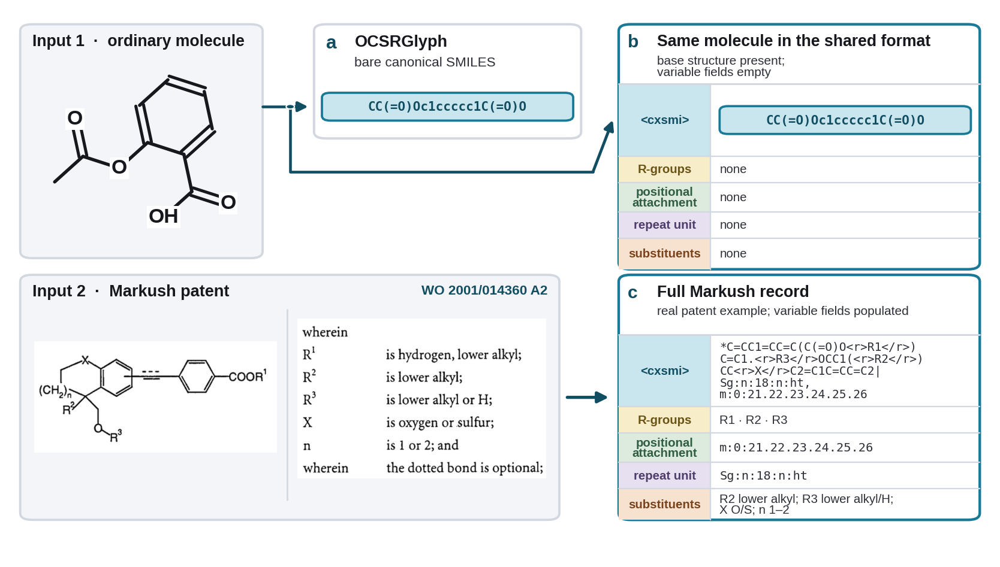
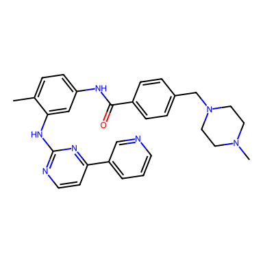
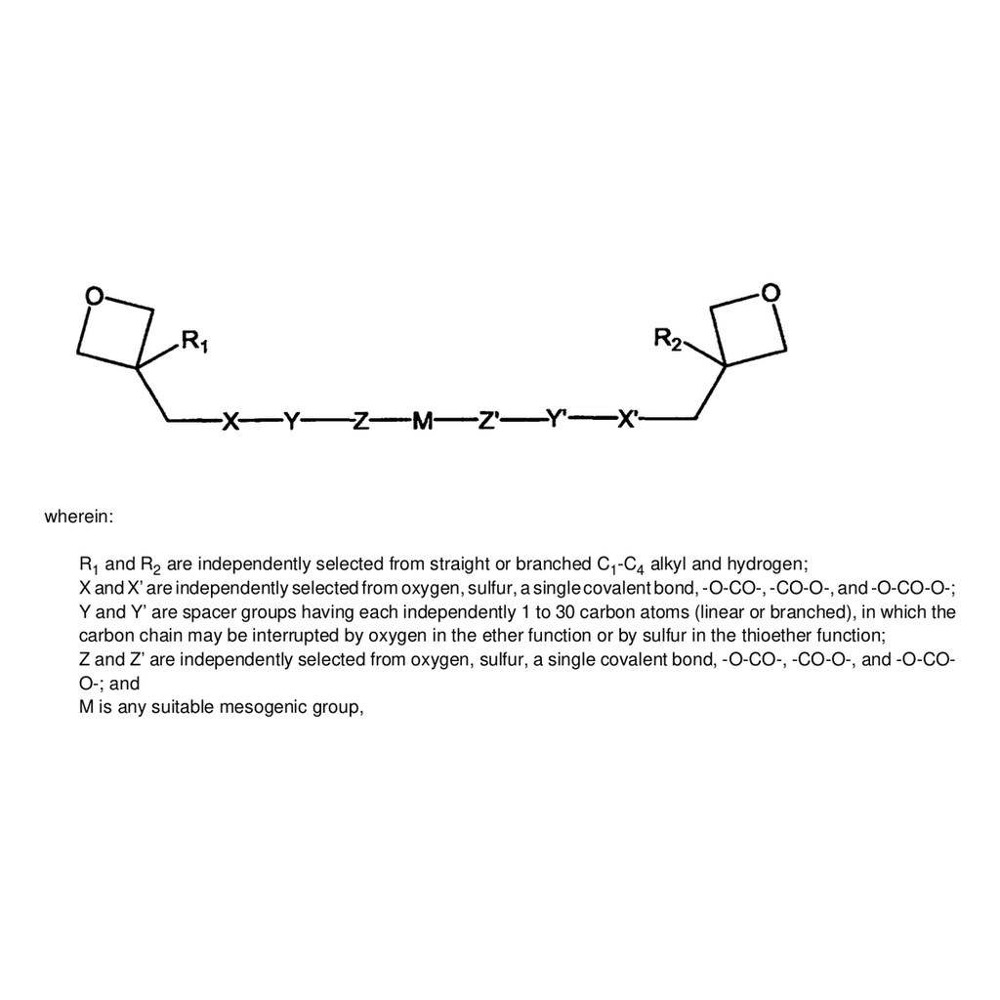

# Glyph: Improved Chemical Structure Recognition

[](https://github.com/EdisonScientific/glyph/actions/workflows/ci.yml)
[](LICENSE)
[](https://www.python.org/)
[](https://huggingface.co/EdisonScientific/OCSRGlyph)
[](https://huggingface.co/EdisonScientific/MarkushGlyph)
[](https://huggingface.co/datasets/EdisonScientific/glyph-datasets)

**Glyph** is a pair of image-to-sequence models that translate chemical structure drawings into machine-readable strings:

- **OCSRGlyph** is a lightweight vision encoder-decoder (Swin-B encoder, 6-layer transformer decoder) that reads an image of a molecular structure and writes a SMILES string, the task known as optical chemical structure recognition (OCSR).
- **MarkushGlyph** is a Qwen3.5-2B vision-language model, fine-tuned with LoRA, that reads a patent Markush structure and writes CXSMILES, which is a standardized format for representing chemical structures with R-groups, positional attachments, and repeat-unit groups.

Both models set the state of the art on the established benchmarks for their task. OCSRGlyph attains the best reported accuracy on the USPTO OCSR benchmark under three stereochemistry conventions present in the literature, ahead of prior systems such as MolScribe, MolNexTR, MolParser, and MolSight. MarkushGlyph outperforms MarkushGrapher-2, the previous best Markush recognition system, on the IP5-M, M2S, and USPTO-Markush benchmarks. See [Results](#results).



We release the model weights, the `glyph` command-line and Python interfaces, and the full training, data preparation, and evaluation code behind the paper. Checkpoints and benchmarks download automatically from Hugging Face the first time you use them.

**Resources:** [OCSRGlyph weights](https://huggingface.co/EdisonScientific/OCSRGlyph) | [MarkushGlyph weights](https://huggingface.co/EdisonScientific/MarkushGlyph) | [Datasets](https://huggingface.co/datasets/EdisonScientific/glyph-datasets) | Paper: *MarkushGlyph and OCSRGlyph: Improved Chemical Structure Recognition* (arXiv link on release)

## Quickstart

You can try both models right away, with nothing to clone or install beyond [uv](https://docs.astral.sh/uv/). [`scripts/glyph_infer.py`](scripts/glyph_infer.py) is a self-contained [PEP 723](https://peps.python.org/pep-0723/) script: uv resolves its dependencies on the fly, and the model weights download automatically.

```bash
uv run https://raw.githubusercontent.com/EdisonScientific/glyph/main/scripts/glyph_infer.py --model ocsr image.png      # molecule image → SMILES
uv run https://raw.githubusercontent.com/EdisonScientific/glyph/main/scripts/glyph_infer.py --model markush image.png   # Markush image → CXSMILES
```

The image argument can be a local file or a URL. If you want batching, JSON output, or decoding options, install the package and use the `glyph` CLI below.

## Installation

Dependencies are managed with [uv](https://docs.astral.sh/uv/). Clone the repository, create a virtual environment, and sync the extras for the models you need:

```bash
uv venv
uv sync --extra ocsr        # OCSRGlyph (torch, timm, rdkit, datasets)
uv sync --extra markush     # MarkushGlyph (torch, transformers, peft, accelerate)
uv sync --extra all         # both models, plus the training-only extras
```

This installs the `glyph` console script. The commands in this README invoke it with `uv run`, which uses the synced environment directly; there is no virtualenv to activate. If you prefer plain pip:

```bash
pip install -e '.[all]'
```

If you also want the pinned DS4SD MarkushGrapher-2 scorer used in the Markush evaluation, run `./setup.sh --extra all` instead; the script is idempotent, so you can re-run it safely. Training needs the `train` extra (fused cross-entropy kernels), which `all` already includes.

<details>
<summary><strong>GPU note:</strong> Blackwell / RTX 50-series cards need CUDA 12.8 wheels</summary>

Blackwell (sm_120) cards require torch >= 2.7 built for CUDA 12.8. With uv this is automatic: `pyproject.toml` routes torch and torchvision to the cu128 index on Linux, so `uv sync` produces an sm_120-capable build.

Plain pip ignores that routing and pulls a default torch build whose kernels stop at sm_90, which fails on Blackwell with "no kernel image available". Install the cu128 wheels first, then the package:

```bash
pip install torch torchvision --index-url https://download.pytorch.org/whl/cu128
pip install -e '.[all]'
```

</details>

## Inference

Both models predict from a single image, on one CUDA GPU or on CPU (`--device cpu` on the CLI, `device="cpu"` in Python). Checkpoint arguments accept a Hugging Face repo id or a local path; if you leave them out, the released weights (`EdisonScientific/OCSRGlyph`, `EdisonScientific/MarkushGlyph`) download on first use.

### OCSRGlyph: molecule image → SMILES



```bash
uv run glyph ocsr predict examples/imatinib.png
# Cc1ccc(NC(=O)c2ccc(CN3CCN(C)CC3)cc2)cc1Nc1nccc(-c2cccnc2)n1
```

That is imatinib (C29H31N7O); the predicted SMILES canonicalizes to the PubChem reference. Stereochemistry is preserved, including `@`/`@@` tetrahedral tags and `/`, `\` double-bond geometry. The same predictor is available in Python:

```python
from glyph.ocsr.predict import OCSRPredictor

predictor = OCSRPredictor("EdisonScientific/OCSRGlyph")   # or a local model.pth
print(predictor.predict("examples/imatinib.png"))
# Cc1ccc(NC(=O)c2ccc(CN3CCN(C)CC3)cc2)cc1Nc1nccc(-c2cccnc2)n1
```

Useful flags: `--json` for structured output, `--no-postprocess` to skip the light SMILES cleanup applied by default, `--device cpu` to force CPU.

### MarkushGlyph: Markush image → CXSMILES



```bash
uv run glyph markush predict examples/markush_m2s_13.png
# *C1(C*******CC2(*)COC2)COC1 |$R1;;;X;Y;Z;M;Z';Y';X';;;R2;;;;;;$|
```

The output is standard CXSMILES: R-group labels appear in the `$...$` block, along with positional (`m:`) and repeat-unit (`Sg:n`) variations when present. Here the prediction matches the M2S ground truth exactly. In Python:

```python
from glyph.markush.inference import MarkushPredictor

predictor = MarkushPredictor(
    checkpoint="EdisonScientific/MarkushGlyph",   # LoRA adapter, or a local directory
    base_model="Qwen/Qwen3.5-2B-Base",
)
result = predictor.predict("examples/markush_m2s_13.png")
print(result.cxsmiles)
# *C1(C*******CC2(*)COC2)COC1 |$R1;;;X;Y;Z;M;Z';Y';X';;;R2;;;;;;$|
```

Useful flags: `--json` for the full record, `predict-batch a.png b.png --output preds.jsonl` for many images, `--format cxsmiles_opt` for the `<r>LABEL</r>` output form, and `--majority-vote --vote-k 8` to replace greedy decoding with self-consistency sampling.

More example images with their expected outputs are listed in [examples/README.md](examples/README.md).

## Results

### Molecular structure recognition (OCSR)

Exact-match accuracy (%) on the USPTO OCSR benchmark (5,719 images) under three stereochemistry conventions: *canonical* requires all stereochemistry to be correct, *chirality-kept* ignores cis/trans geometry, and *graph* compares connectivity only.

| Model       | Canonical | Chirality-kept | Graph |
| ---         | --- | --- | --- |
| DECIMER 2.7 | 58.4 | — | 61.5 |
| MolGrapher  | 65.7 | — | 91.5 |
| MolScribe   | 88.4 | 92.6 | 94.6 |
| MolParser   | — | 93.0 | — |
| MolNexTR    | — | 93.8 | — |
| MolSight    | 92.0 | — | 94.0 |
| **OCSRGlyph** | **93.8** | **93.9** | **96.2** |

Baseline values are each system's own reported numbers, filled in with MolSight's re-evaluation where a paper does not report a convention; the paper gives the details. You can reproduce the OCSRGlyph row with one command; the benchmark downloads automatically:

```bash
uv run glyph ocsr eval --checkpoint EdisonScientific/OCSRGlyph --output uspto5719.json
# A/B/C = 93.8 / 93.9 / 96.2  (canonical / chirality-kept / graph)
```

### Markush structure recognition

Accuracy (%) under the official MarkushGrapher-2 scorer, over the full benchmarks (878, 103, and 74 rows respectively; a prediction that cannot be parsed counts as incorrect):

| Model | IP5-M | M2S | USPTO-Markush |
| --- | --- | --- | --- |
| MolScribe | 22.3 | 21.0 | 7.0 |
| MolParser-Base | 47.7 | 39.0 | 30.0 |
| MarkushGrapher-1 | — | 38.0 | 32.0 |
| MarkushGrapher-2 | 53.2 | 56.0 | 55.0 |
| **MarkushGlyph, greedy** | **58.2** | **61.2** | **59.5** |
| **MarkushGlyph, MV@8** | **60.6** | **62.1** | **63.5** |

Baseline rows are the published numbers. For MarkushGrapher-2 on IP5-M we instead report its released predictions re-scored with the same pinned scorer over the same 878 rows (53.2%; the published number is 53.7%). Greedy decoding is the default; majority voting (MV@8) is opt-in.

You can reproduce any MarkushGlyph cell with two commands: the first generates predictions, the second scores them. Swap `ip5m` for `m2s` or `uspto_markush` to run the other benchmarks.

```bash
uv run glyph markush eval benchmark --benchmark ip5m \
    --checkpoint EdisonScientific/MarkushGlyph --base-model Qwen/Qwen3.5-2B-Base \
    --output preds.json

tools/mg2_scorer/score_benchmark.sh --benchmark ip5m --input-json preds.json
# ip5m greedy: 58.2% (511 / 878 in the paper's run)
```

The scorer prints a second number next to the official one: a stricter parsed-graph equality metric we introduce in the paper (52.1% for IP5-M greedy). We document both scoring contracts, the MV@8 commands, the pinned dataset revisions, and the DS4SD ground-truth provenance in [docs/reproducing.md](docs/reproducing.md). To regenerate the MarkushGrapher-2 baseline itself, see [tools/mg2_scorer/MG2_BASELINE.md](tools/mg2_scorer/MG2_BASELINE.md); for the paper's frontier-model baselines, see [tools/frontier_baseline/README.md](tools/frontier_baseline/README.md).

## Training

We release the training code and configs for both models. Configs resolve paths under `GLYPH_DATA_ROOT` (see [Data](#data)) and carry the paper hyperparameters inline. The frozen training data we host on `EdisonScientific/glyph-datasets` downloads automatically.

### OCSRGlyph

```bash
export GLYPH_DATA_ROOT=/path/to/data
export WANDB_MODE=offline                        # or set WANDB_API_KEY for online logging
uv run glyph data prepare --ocsr --allow-large   # PubChem-1M + USPTO-680K + Stereo-200K
uv run scripts/train_ocsrglyph.sh
```

The recipe ([`configs/ocsr/ocsrglyph-stereo-enriched.yaml`](configs/ocsr/ocsrglyph-stereo-enriched.yaml)): Swin-B/384 encoder, 6-layer transformer decoder, ImageNet-pretrained backbone, effective batch 256, 100k steps, cosine LR 4e-4, label smoothing 0.1. The data mix is PubChem-1M + USPTO-680K + Stereo-200K (x2) + `adjacent_ring` (x2), where "x2" means loader repeats. The launcher uses all visible GPUs; set `NUM_GPUS=8` to pin the published 8-GPU topology, and lower `BATCH_SIZE_PER_GPU` (recipe value 32, sized for 80 GB cards) on smaller GPUs.

### MarkushGlyph

```bash
export GLYPH_DATA_ROOT=/path/to/data
uv run glyph data prepare --markush --allow-large   # source images
uv run torchrun --nproc_per_node 8 -m glyph.markush.train.sft \
    --config configs/ablations/ocsr-as-markush-fraction/sft_2b_markush_ocsr5pct.yaml \
    --data-path hub:markush/train.jsonl
```

This is the released recipe: LoRA (rank 128, alpha 128) on `Qwen/Qwen3.5-2B-Base`, trained on the released 263,158-row index (`hub:markush/train.jsonl`, downloaded automatically) with 5% standard-molecule OCSR data mixed in. The paper run uses the `train` extra for FLA's fused cross-entropy kernel; without it the trainer warns once and falls back to standard cross-entropy, which computes the same loss but uses more memory.

<details>
<summary>Quick launch checks (2 steps, one GPU)</summary>

Confirm the OCSR trainer launches; the `adjacent_ring` data downloads and renders on the fly, so no other data is needed:

```bash
WANDB_MODE=offline uv run python -m glyph.ocsr.train \
    --pubchem_csv hub:adjacent_ring --max_pubchem_rows 64 --backbone_pretrained \
    --batch_size 4 --max_steps 2 --eval_n 0 --write_checkpoint --checkpoint_every_steps 2 \
    --output_dir "$GLYPH_DATA_ROOT/checkpoints/ocsr/launch-check"
```

For the Markush trainer, once the source images are prepared, add these flags to the training command above:

```
--max-steps 2 --eval-size 4 --metrics-eval-size 0 --no-wandb
```

</details>

## Data

All artifacts live under one portable root. Set `GLYPH_DATA_ROOT` (default `./data`); configs and launchers expand it at load time, so they are portable across machines.

```bash
export GLYPH_DATA_ROOT=/path/to/data

uv run glyph data prepare --ocsr --allow-large      # OCSR training sources (multi-GB)
uv run glyph data prepare --markush --allow-large   # Markush training image sources
```

These commands pull the public sources, preprocess them, and lay everything out under the data root. The Markush command downloads roughly 32 GB of upstream archives, then materializes only the 231,537 images that the released training index references. Use `--dry-run` to preview the download cost first. (`--limit N` caps how many rows are materialized, but the upstream archives still download in full.)

Evaluation does not need any of this: benchmarks download automatically as self-contained files when you run `glyph ocsr eval` or `glyph markush eval benchmark`.

<details>
<summary>Data root layout</summary>

```
$GLYPH_DATA_ROOT/
  datasets/ocsr/{pubchem_1m, uspto_680k, stereo_200k_white, adjacent_ring}
  datasets/markush/{mg1_synthetic, mg2_structure_only, molparser, ordinary_5pct}/
  datasets/markush/train.jsonl                 # released flat training index (optional local copy)
  images/{mg1_synthetic, uspto_mol_m, molparser, molscribe}/train/<source_id>.png
  benchmarks/ocsr/uspto_ocsr_5719_complete.csv
  benchmarks/markush/{ip5m, m2s, uspto_markush}/eval_*.jsonl
  eval_out/                                    # evaluation artifacts
  models/   checkpoints/
```

Two directory pairs hold the same sources under different names: `datasets/markush/mg2_structure_only` corresponds to `images/uspto_mol_m`, and `datasets/markush/ordinary_5pct` corresponds to `images/molscribe`. The training index keys images by the `images/` names.

The released training index (`hub:markush/train.jsonl`) resolves automatically, so downloading it by hand is optional. To use a local copy, place it at `$GLYPH_DATA_ROOT/datasets/markush/train.jsonl`.

</details>

<details>
<summary>Dataset provenance and redistribution</summary>

Artifacts fall into three redistribution classes: **(a)** referenced upstream (pulled from the pinned public source at load time, not re-hosted), **(b)** transformed metadata (our derived label, index, and subset files, which carry no upstream image bytes), and **(c)** embedded copies (the frozen self-contained eval files, which do embed the benchmark images and labels so evaluation runs without reconstruction).

| Dataset | Rows | Origin | Redistribution |
| --- | --- | --- | --- |
| PubChem-1M | 1M | MolNexTR (public) | (a) CSV re-fetched, images rendered on the fly |
| USPTO-680K | 680K | MolNexTR (public) | (a) images re-fetched |
| Stereo-200K (`stereo_200k_white`) | 200K | MolSight | (b) white-crop SMILES + paths; base images re-fetched |
| `adjacent_ring` | 64,752 | This work: mined subset of PubChem-1M | (b) derived CSV; mining script included |
| Standard molecules 5% (OCSR-as-Markush) | 13,158 | MolScribe pool | (a) referenced; held out from the OCSR benchmarks |
| MG1-synthetic | 152,620 | `docling-project/MarkushGrapher-Datasets` | (a) referenced |
| USPTO-MOL-M | 52,524 | `docling-project/MarkushGrapher-2-Datasets` | (a) referenced |
| MolParser | 44,856 | `UniParser/MolParser-7M` | (a) referenced |
| Benchmarks: IP5-M / M2S / USPTO-Markush | 878 / 103 / 74 | `docling-project/MarkushGrapher-2-Datasets` | (c) 1,055 images + targets embedded in the frozen eval files |
| Benchmark: USPTO-OCSR-5719 | 5,719 | `hheiden/USPTO_OCSR_benchmark` + MolScribe label recovery | (c) images + complete labels embedded in the frozen eval file |

The only original training data is `adjacent_ring`, a mined subset of PubChem-1M; `glyph data prepare --ocsr` runs the mining script (`glyph/data/ocsr_adjacent_ring.py`). The pinned source revisions are listed in [docs/reproducing.md](docs/reproducing.md).

</details>

## Acknowledgments

Glyph builds on several open projects. OCSR training images are rendered on the fly with [**EPAM Indigo**](https://github.com/epam/Indigo), and some of our chemistry utilities are adapted from [**MolScribe**](https://arxiv.org/abs/2205.14311). The OCSR tokenizer follows the char-SMILES vocabulary and recipe of [**MolNexTR**](https://arxiv.org/abs/2403.03691), whose public PubChem-1M and USPTO-680K datasets we also train on. Stereo-200K is contributed by [**MolSight**](https://arxiv.org/abs/2511.17300). Markush evaluation uses the official [**MarkushGrapher / MarkushGrapher-2**](https://github.com/DS4SD/MarkushGrapher) (DS4SD) scorer unmodified at [pinned commits](tools/mg2_scorer/VENDOR_COMMITS.md).

## Third-party components

The repository is licensed under Apache-2.0 (see [`LICENSE`](LICENSE)). Vendored or adapted components, including model weights, datasets, and third-party dependencies used with this project, keep their own upstream licenses. Please review and comply with those licenses when using them.

## Citation

This code accompanies the paper *MarkushGlyph and OCSRGlyph: Improved Chemical Structure Recognition*. The BibTeX entry and arXiv identifier will be added on release.
