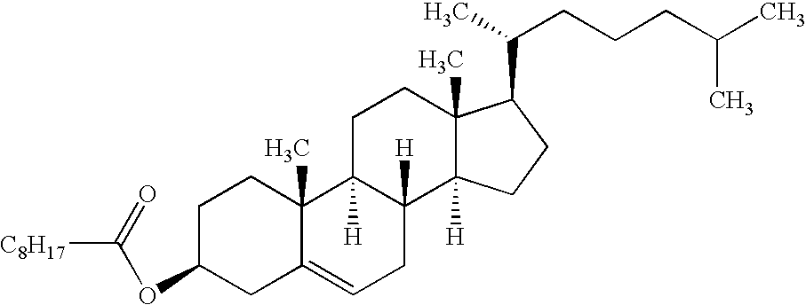

# Example images

Small, runnable inputs for the [Inference section](../README.md#inference) of the main README.
Every command in that section is verified against these files. Outputs below are
the default **greedy** decode.

## OCSRGlyph (standard molecules → SMILES)


`imatinib.png` → imatinib (C29H31N7O); its canonical SMILES matches the PubChem
reference exactly.

```
Cc1ccc(NC(=O)c2ccc(CN3CCN(C)CC3)cc2)cc1Nc1nccc(-c2cccnc2)n1
```



`cholesterol_ester.png` →

```
CCCCCCCCC(=O)O[C@H]1CC[C@@]2(C)C(=CC[C@H]3[C@@H]4CC[C@H]([C@H](C)CCCC(C)C)[C@@]4(C)CC[C@@H]32)C1
```

## MarkushGlyph (patent Markush structures → CXSMILES)


`markush_m2s_13.png` is a Markush crop from the M2S benchmark. The default output
is standard `|$...$|` CXSMILES, reproducing the ground truth exactly:

```
*C1(C*******CC2(*)COC2)COC1 |$R1;;;X;Y;Z;M;Z';Y';X';;;R2;;;;;;$|
```

`*` marks an R-group / variable, labelled in the trailing `$` block; `m:` denotes
a positional variation and `Sg:n` a frequency (repeat-unit) variation — the
CXSMILES extensions that make a structure Markush rather than a single molecule. Pass
`--format cxsmiles_opt` to emit the equivalent `<r>LABEL</r>` form instead.
